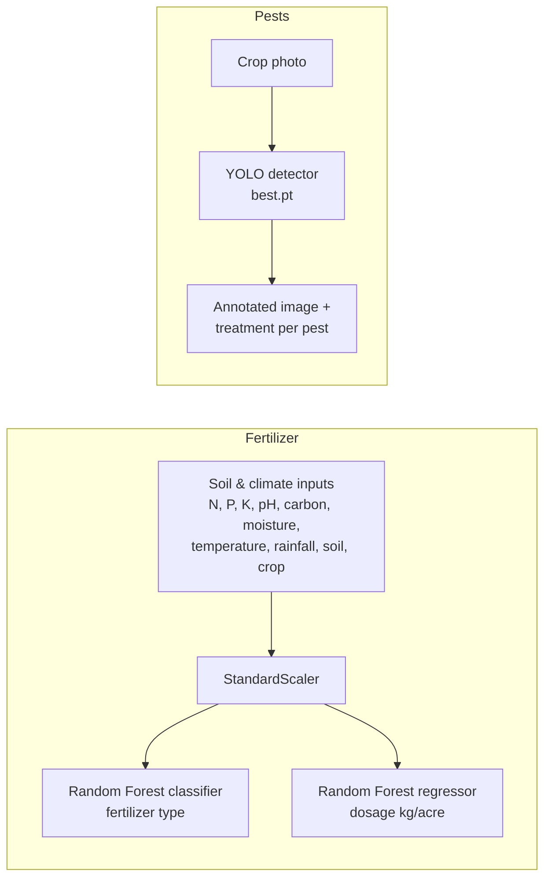

# Fertilizer Recommendation & Pest Detection

An AI assistant for farmers with two tools:

1. **Fertilizer recommendation** — enter soil test values and the crop; two Random Forest models recommend the right fertilizer and how much to apply (kg/acre), with a short explanation.
2. **Pest detection** — upload a photo of a crop or leaf; a YOLO object-detection model finds pests, draws bounding boxes on the image and suggests a treatment for each pest found.

---

## How it works



**Fertilizer models** (`models/`): a scikit-learn `StandardScaler` followed by a Random Forest classifier that picks one of 10 fertilizers (Urea, DAP, Muriate of Potash, Balanced NPK, Compost, Gypsum, Lime, Organic, Water-retaining, General-purpose) and a Random Forest regressor that predicts the dosage. Inputs cover 5 soil types and 31 crops.

**Pest model** (`best.pt`): custom-trained Ultralytics YOLO weights that detect 13 pest classes — aphids, army worm, black cutworm, corn borer, grub, large cutworm, mole cricket, peach borer, *Potosia brevitarsis*, red spider mite, white-margined moth, wireworm and yellow cutworm.

## Tech stack

Python · scikit-learn · pandas · Ultralytics YOLO · PyTorch · Pillow · Flask · HTML / CSS / JavaScript

## Run locally

```bash
python -m venv venv
source venv/bin/activate        # Windows: venv\Scripts\activate
pip install -r requirements.txt
```

Both APIs use port 5000, so run one at a time.

**Fertilizer recommendation API** (from the repository root):

```bash
python server.py
```

Then open `test.html` in a browser, or call the API directly:

```bash
curl -X POST http://127.0.0.1:5000/api/recommend -H "Content-Type: application/json" \
  -d '{"temperature":28,"moisture":40,"rainfall":120,"ph":6.5,"nitrogen":50,"phosphorous":30,"potassium":40,"carbon":0.8,"soilType":1,"cropType":1}'
```

```json
{ "fertilizer": "…", "dosage": "… kg/acre", "remark": "…" }
```

**Pest detection API:**

```bash
cd soil
python server2.py
```

Then open `soil/pest.html` and upload an image (sample images are in `uploads/`). `POST /detect` returns the detected pests, their treatments and a link to the annotated image.

A standalone Flask app with server-rendered templates is also available: `python appcopy.py` (uses `templates/`).

## Project structure

```
├── server.py              fertilizer recommendation API
├── app.py                 model loading, prediction and remarks
├── models/                scaler and Random Forest models
├── best.pt                trained YOLO pest-detection weights
├── soil/
│   ├── server2.py         pest detection API
│   ├── pest_detection.py  YOLO inference and treatments
│   └── pest.html          pest detection UI
├── appcopy.py, templates/ standalone pest-detection web app
├── test.html, soil_analysis.html, report/, login.html   web UI pages
└── uploads/               sample pest images
```
